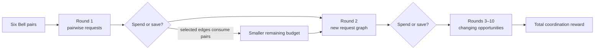
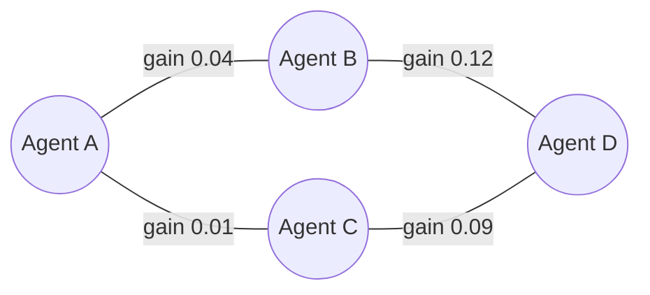
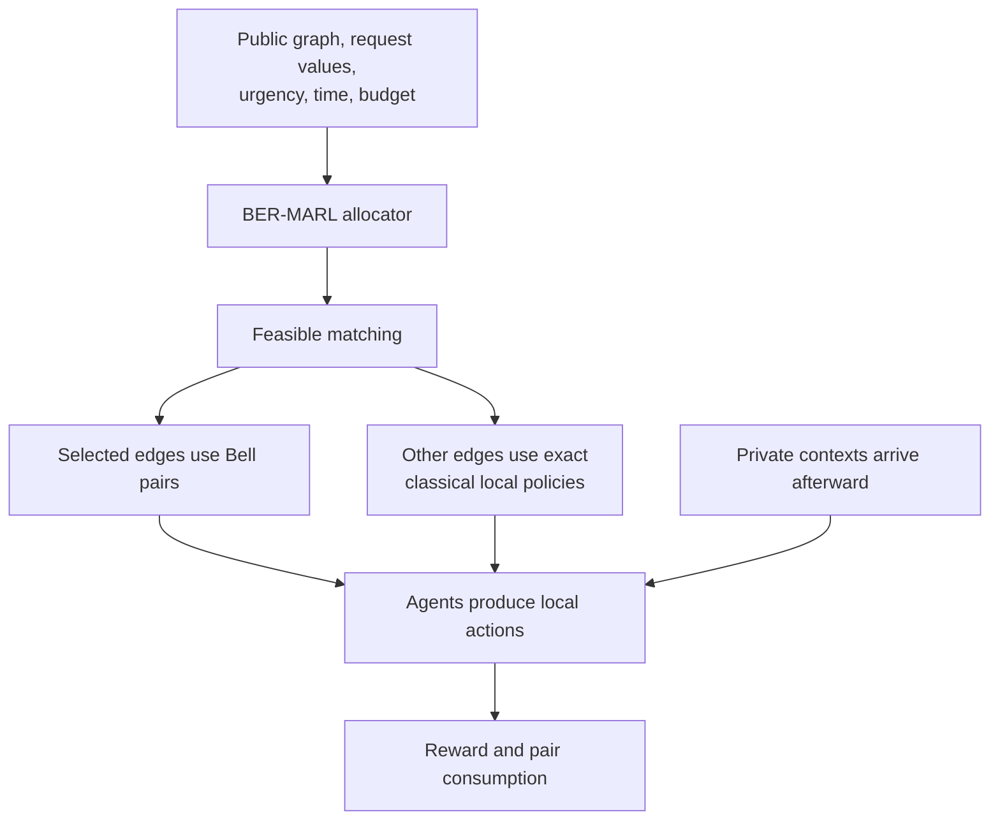
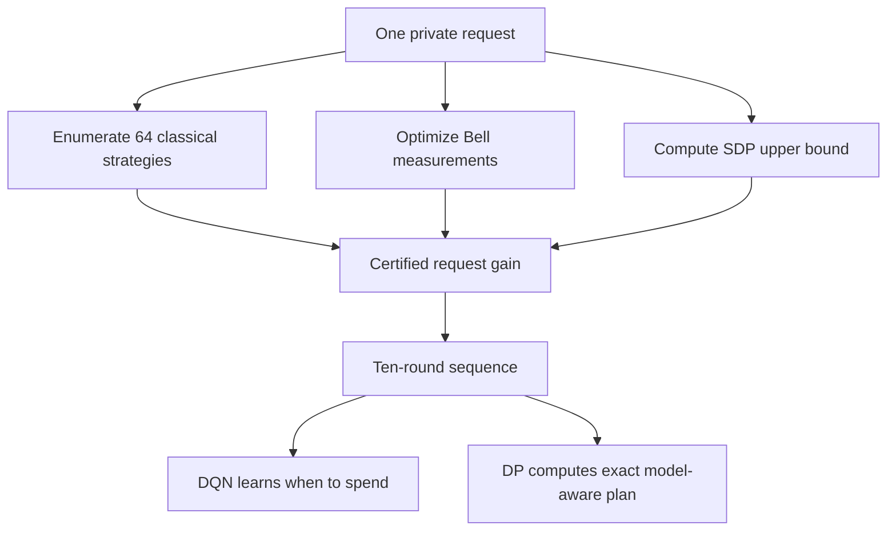
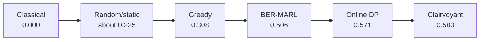

# Budgeted Entanglement Routing for Sequential Multi-Agent Reinforcement Learning

## Abstract

Entanglement-assisted multi-agent studies commonly assume that a fixed pair of agents can use entanglement whenever needed. We study a different control problem: several decentralized agents share a small, consumable supply of Bell pairs and must decide where and when to use them. Four agents face a changing graph of private-information coordination requests over ten time steps. A resource controller sees only public information and must route six Bell pairs across the episode. Each allocation must be a matching, because an agent cannot simultaneously share independent Bell pairs with multiple partners through one interface. Every selected edge consumes one pair.

We introduce **BER-MARL**, Budgeted Entanglement Routing for Multi-Agent Reinforcement Learning. It uses a masked Deep Q-Network to decide whether to spend or save Bell pairs. Each request is a three-input binary-output coordination game. We calculate its best zero-communication classical value by exhaustive enumeration and independently bound its entangled value with a semidefinite program. This separates the value of an individual Bell pair from the learned decision about when to use it.

In a locked evaluation with 16 independent training seeds and 1,000 paired held-out sequences per seed, BER-MARL achieved mean entanglement surplus `0.5064`, compared with `0.3084` for myopic greedy, `0.2268` for random, and `0.2248` for static allocation. The paired BER-MARL-minus-greedy difference was `0.1980`, with 95% bootstrap interval `[0.1914, 0.2043]`; every training seed was positive. BER-MARL recovered `88.66%` of the exact online dynamic-programming surplus. A preregistered requirement that the one-sided lower bound exceed 90% was not met: the bound was `87.68%`. The strongest near-oracle composite claim is therefore rejected. The supported contribution is a certified sequential benchmark and evidence that learned routing substantially improves the use of scarce entanglement under held-out task and transition distributions.

## 1. The problem in one picture

Suppose four agents have six Bell pairs for an episode lasting ten rounds. At every round, several pairs of agents receive coordination jobs. Some jobs benefit greatly from entanglement, some benefit only slightly, and some do not benefit at all. Jobs can also have different urgency.

The controller must answer:

> Which agent pairs should receive Bell pairs now, and how many pairs should be saved for later?



A greedy controller spends on the most valuable requests visible now. That can be wasteful when rare, urgent requests may appear later. BER-MARL learns this timing tradeoff.

## 2. A concrete round

Consider four agents, `A`, `B`, `C`, and `D`. In one round, the public graph might be:



The controller cannot select both `A-B` and `A-C`, because agent `A` would be used twice. It cannot select both `B-D` and `C-D`, because agent `D` would be used twice. Valid allocations include no edge, one active edge, `A-B` with `C-D`, or `A-C` with `B-D`.

The greatest immediate matching is `A-C` plus `B-D`, with gain `0.13`. Spending two Bell pairs may nevertheless be wrong if only two pairs remain and valuable future requests are likely.



Allocation occurs **before** private contexts arrive. This prevents the shared controller from solving the private coordination problem through ordinary communication.

## 3. One coordination request

Each endpoint privately observes one symbol from `{0,1,2}`. Call them `x` and `y`. Each endpoint produces one binary action, `a` and `b`. These outputs are abstract coordination answers. In the implemented benchmark they do not move a robot, select a physical channel, or change the environment. Their purpose is to test whether two separated agents can satisfy a joint rule without revealing their private inputs.

A public `3 × 3` table specifies the desired parity:

\[
a \oplus b = f(x,y).
\]

An example table is:

| Private `x` / private `y` | 0 | 1 | 2 |
|---|---:|---:|---:|
| 0 | 1 | 0 | 1 |
| 1 | 0 | 0 | 1 |
| 2 | 1 | 1 | 0 |

If `x=1` and `y=2`, the table entry is `1`. The agents win with either of these outcomes:

| Agent one output `a` | Agent two output `b` | `a XOR b` | Outcome |
|---:|---:|---:|---|
| 0 | 1 | 1 | Win |
| 1 | 0 | 1 | Win |
| 0 | 0 | 0 | Lose |
| 1 | 1 | 0 | Lose |

No rule says which agent must output `0`. Only the relationship between the outputs matters. When a table entry is `0`, both `(0,0)` and `(1,1)` win. Context pairs have nonuniform weights, so some cells occur more often.

### 3.1 Why this is a game rather than a trivial lookup

One table cell is easy. If the agents knew they would only receive `(x,y)=(1,2)`, they could pre-agree that one always outputs `0` and the other outputs `1`. The challenge is that each agent sees only half of the input and must use one local rule across all nine possible cells.

Conflicting cells can make perfect classical play impossible. Consider four requirements:

| Inputs | Required relation |
|---|---|
| `(0,0)` | Same |
| `(0,1)` | Same |
| `(1,0)` | Same |
| `(1,1)` | Different |

The first three requirements force the relevant local outputs to be equal, while the fourth requires them to differ. No fixed pair of local classical rules can satisfy all four. A Bell pair can generate stronger correlations across the complete table without transmitting either private input.

The current study deliberately keeps the outputs abstract so that the classical and quantum optima can be certified exactly. A future application could interpret the bits as two channels, two sensing modes, or act/wait decisions, but those physical meanings were not implemented and are not claimed here.

### 3.2 Exact classical value

Without communication, the agents use local functions:

\[
a=g(x), \qquad b=h(y).
\]

There are eight deterministic binary functions of a three-valued input. Therefore, only `8 × 8 = 64` deterministic strategy pairs exist. We enumerate all 64. Shared classical randomness cannot improve the expected optimum because it only mixes deterministic strategies and reward is linear in that mixture.

This gives the exact classical value `V_C`.

### 3.3 Bell-assisted value

For an entangled request, the endpoints share one Bell pair:

\[
|\Phi^+\rangle = \frac{|00\rangle+|11\rangle}{\sqrt{2}}.
\]

Each endpoint selects a local measurement using only its own private symbol. The binary measurement outcomes become `a` and `b`; no private symbol is communicated.

Optimizing six local angles gives a Bell-assisted value `V_Q`. An independent XOR-game semidefinite program, or SDP, supplies an upper bound. The optimized policies match those bounds to numerical tolerance.

The value of using a Bell pair on request `e` is:

\[
G_e=u_e\max(0,V_{Q,e}-V_{C,e}),
\]

where `u_e` is urgency. Some committed request types have `G_e=0`, so a good router must avoid wasting pairs on them.

## 4. The sequential benchmark

| Property | Registered value |
|---|---:|
| Agents | 4 |
| Episode length | 10 rounds |
| Initial Bell-pair budget | 6 |
| Active requests per round | 3–5 |
| Private contexts per endpoint | 3 |
| Actions per endpoint | 2 |
| Physical agent edges | 6 |
| Global matching actions | 10 |

The public graph follows a committed Markov process. Common low-value requests and rarer high-urgency requests make saving useful. Each active edge carries its own request type and urgency. An agent may answer several requests classically in one round, but the matching constraint prevents it from receiving entanglement on multiple edges simultaneously.

At round `t`, the allocator sees the active graph, certified gains, urgency, remaining budget `B_t`, and remaining horizon. It never sees private contexts or post-context messages.

For selected matching `M_t`, immediate entanglement surplus is:

\[
r_t=\sum_{e\in M_t}G_e,
\]

and the budget evolves as:

\[
B_{t+1}=B_t-|M_t|.
\]

The primary outcome is total surplus:

\[
S=\sum_{t=1}^{10}r_t.
\]

This equals total return minus the exact classical zero-message return on the same sequence.

The allocation experiment uses the **exact expected success value** of each frozen local request policy. It does not sample individual private contexts during allocator training or final evaluation. The context distribution is integrated into `V_C` and `V_Q` first, and the resource controller then learns from the resulting certified gains. Thus the experiment isolates entanglement scheduling from statistical noise in the local games.

## 5. BER-MARL

BER-MARL uses a masked Deep Q-Network, or DQN. It estimates the future value of every feasible allocation:

\[
Q(s,a)\approx \text{expected current and future surplus after action }a.
\]

Its 14 inputs are six edge gains, six activity bits, remaining budget, and remaining horizon. Two hidden layers contain 64 units each. Its ten outputs represent one empty matching, six single-edge matchings, and three disjoint two-edge matchings. Inactive and over-budget actions are masked.


Training uses experience replay, Adam with learning rate `5×10⁻⁴`, batches of 64, and a target network updated every 200 optimization steps. Each final seed trains for 2,500 episodes on development and validation catalogs. Final evaluation uses a new request family, transition catalog, and sequence stream without adaptation.

The proposed decision procedure is:

```text
Input: public request graph, certified gains, remaining budget, remaining time
1. Encode the six possible edges and the two budget/time variables.
2. Predict a long-term Q value for each of the ten global matchings.
3. Mask matchings containing inactive edges, repeated agents, or too many Bell pairs.
4. Select the feasible matching with the greatest predicted long-term value.
5. Consume one Bell pair for every selected edge.
6. Store the public transition and received surplus for DQN training.
```

BER-MARL is therefore the **resource allocator**. The endpoint classical and Bell measurement policies are certified and frozen before allocator learning. This distinction prevents the paper from attributing request-level nonlocality to the DQN.

## 6. Bell pair, DQN, PPO, DP, and SDP

| Term | Meaning | Role in this paper |
|---|---|---|
| Bell pair | Two entangled qubits | Consumable resource for one selected request |
| DQN | Deep Q-Network | Current BER-MARL allocator |
| PPO | Proximal Policy Optimization | Possible alternative learned allocator; not in the primary experiment |
| DP | Dynamic programming | Exact model-aware sequential reference |
| SDP | Semidefinite programming | Quantum upper bound for one request |



The SDP asks, “How valuable can entanglement be for this request?” The DP asks, “When should a limited supply be spent across the full episode?”

The DP recurrence is:

\[
J_t(s,b)=\max_{M\in\mathcal{M}(s,b)}\left[G(s,M)+\sum_{s'}P(s'\mid s)J_{t+1}(s',b-|M|)\right].
\]

DP knows the true public transition matrix. BER-MARL learns approximate long-term reasoning from experience.

## 7. Benchmarking methods and why each is included

| Method | Bell budget | Future knowledge | Purpose |
|---|---:|---|---|
| **Classical exact** | 0 | None | Establishes the exact zero-message classical reference |
| **Quantum random** | 6 | None | Tests whether arbitrary entanglement use is sufficient |
| **Quantum static** | 6 | None | Tests fixed priorities learned from non-test frequencies |
| **Quantum greedy** | 6 | Current round only | Strong myopic baseline and primary comparator |
| **BER-MARL** | 6 | Learned from past training episodes | Proposed long-horizon allocator |
| **Online DP oracle** | 6 | True public transition probabilities | Exact model-aware online reference |
| **Future-clairvoyant** | 6 | Entire realized sequence | Unattainable descriptive ceiling |
| **Message oracle** | Not comparable | Private inputs are exchanged | Privileged information reference |

Random, static, greedy, and BER-MARL receive identical held-out sequences, certified local policies, Bell budgets, public observations, and matching constraints. Greedy is the primary comparator because it already makes intelligent use of current certified gains; BER-MARL must add value through long-horizon timing rather than through access to better request policies.

DP is not a trainable competitor under the same information assumptions. It is an upper reference that knows the exact public Markov model. The future-clairvoyant and message oracles are deliberately privileged and cannot support fairness claims.

### 7.1 Classical exact

This method never uses entanglement. Every request is answered with the best deterministic zero-message local strategy found by enumerating all 64 strategy pairs. Its entanglement surplus is exactly zero by definition. It establishes the return that the quantum-assisted allocation methods improve upon, but it is not an equal-resource allocator because it receives no Bell pairs.

### 7.2 Quantum random

At every round, random allocation samples uniformly from the currently feasible matchings. Feasibility includes active edges, no repeated endpoint, and the remaining Bell-pair budget. It receives the same six pairs as BER-MARL. This control answers whether simply distributing entanglement, without reasoning about request value or the future, is sufficient.

### 7.3 Quantum static

Static allocation computes a fixed priority for each physical edge from development and validation frequencies and gains. During evaluation it chooses the feasible active matching with the greatest sum of these fixed edge priorities. It does not use the current request's future value and does not update priorities on the test catalog. This tests whether a fixed deployment plan can replace sequential learning.

### 7.4 Quantum greedy

Greedy uses the full certified gains visible in the current round and selects

\[
M_t^{\mathrm{greedy}}=\arg\max_{M\in\mathcal{M}(s_t,B_t)}\sum_{e\in M}G_e.
\]

It knows which opportunities are valuable now but assigns zero value to preserving budget. Greedy is the primary baseline because BER-MARL and greedy differ mainly in long-horizon reasoning.

### 7.5 BER-MARL

BER-MARL receives the same state, matching set, six-pair budget, and frozen request policies as greedy. It selects the feasible action with the greatest learned Q value:

\[
M_t^{\mathrm{BER}}=\arg\max_{M\in\mathcal{M}(s_t,B_t)}Q_\theta(s_t,B_t,M).
\]

Any improvement over greedy therefore measures learned budget pacing and anticipation of future public states, rather than a better local quantum policy or extra information.

### 7.6 Online dynamic-programming reference

Online DP knows the exact public transition matrix but does not know which random future state will actually occur. It computes the optimal expected action through backward recursion:

\[
J_t(s,b)=\max_{M\in\mathcal{M}(s,b)}\left[G(s,M)+\sum_{s'}P(s'\mid s)J_{t+1}(s',b-|M|)\right].
\]

DP is an upper reference for a model-aware online allocator. It is privileged relative to BER-MARL because the held-out transition matrix is given to it exactly.

### 7.7 Future-clairvoyant reference

The clairvoyant reference receives the complete realized ten-round sequence before making its first decision. It solves a sequence-specific matching and budget optimization. It is at least as strong as online DP and is unattainable in normal operation. Its purpose is to show the maximum surplus left in each realized sequence.

### 7.8 Message oracle

The message oracle allows endpoints to exchange their private inputs before acting. They can then select joint outputs satisfying every parity request. It uses a stronger information channel and is not constrained to solve the same zero-message problem. Its much larger reward is reported only to quantify the value of unrestricted communication; it is excluded from allocator superiority comparisons and the main results chart.

### 7.9 Which comparisons support the claim

The direct fair comparisons are BER-MARL versus random, static, and greedy. Online DP measures remaining model-aware headroom. The future-clairvoyant and message oracles are descriptive ceilings. Classical exact defines the zero-surplus reference. None of the privileged references is used as evidence that BER-MARL is superior under equal information.

## 8. Prospective experimental design


Development tested four DQN configurations with two seeds each, then four fresh pilots. Before final access, the protocol fixed 16 final training seeds, 2,500 episodes per seed, 1,000 paired held-out sequences, final-checkpoint evaluation, 20,000 bootstrap replicates, and five positive-result conditions. The independent training seed—not the episode—is the statistical unit.

## 9. Results

| Method | Mean surplus | Meaning |
|---|---:|---|
| Classical exact | 0.00000 | Surplus reference |
| Quantum static | 0.22478 | Fixed allocation priorities |
| Quantum random | 0.22685 | Random feasible allocation |
| Quantum greedy | 0.30839 | Best visible immediate gain |
| **BER-MARL** | **0.50642** | Learned long-horizon allocation |
| Exact online DP | 0.57122 | Model-aware online reference |
| Future-clairvoyant | 0.58326 | Realized future is known |

BER-MARL exceeded greedy by:

\[
0.50642-0.30839=0.19803.
\]

The paired-seed 95% bootstrap interval was `[0.19141,0.20432]`. All 16 seeds were positive. Relative to greedy surplus, the improvement was:

\[
\frac{0.19803}{0.30839}=64.2\%.
\]



BER-MARL recovered `88.66%` of online-DP surplus. The one-sided 95% lower bound was `87.68%`, below the preregistered requirement of more than 90%.

### Five-part result gate

| Condition | Outcome |
|---|---|
| Paired BER-MARL-minus-greedy lower bound above zero | Passed |
| Improvement at least 5% of DP surplus | Passed |
| BER-MARL/DP one-sided lower bound above 90% | **Failed** |
| BER-MARL surplus lower bound above zero | Passed |
| Exact budget and matching constraints | Passed |

Four of five conditions passed. The full composite gate failed, while the learned-versus-greedy result remained strongly positive.

The 12 held-out games had Bell-minus-classical gaps from `0` to `0.03830`, mean `0.01760`. Zero-gap types remained in the test. The independent audit re-enumerated every classical optimum, resolved every SDP ceiling, and reproduced the analysis from raw rows.

### 9.1 Discussion of the result

Three observations follow from the method ordering. First, random and static allocation are nearly identical, showing that merely possessing Bell pairs is insufficient. Second, greedy improves substantially over those controls, so current request value is informative. Third, BER-MARL closes most of the remaining gap to DP, demonstrating that budget pacing and future opportunity value matter beyond immediate gain.

The difference between BER-MARL (`0.50642`) and DP (`0.57122`) is also scientifically important. It shows that the learned policy transfers useful scheduling structure to a new catalog but does not fully reconstruct its transition dynamics. This is consistent with the failed 90%-lower-bound condition and identifies online public-model adaptation as a concrete next method rather than an explanation invented after a null result.

The classical-exact row should not be compared numerically with the other rows as if all methods used equal physical resources: it intentionally uses no Bell pairs and defines zero surplus. The relevant allocator comparison is among random, static, greedy, BER-MARL, and DP, all of which share the six-pair constraint.

## 10. What is and is not established

The evidence supports:

> Under the ideal Bell-pair and zero-message information model, BER-MARL learned to route a consumable entanglement budget across an unseen dynamic graph and achieved substantially greater held-out surplus than random, static, and myopic allocation.

It does not establish a new Bell inequality, a new theorem that entanglement can beat local strategies, quantum computational speedup, hardware advantage, performance above the registered 90%-of-DP confidence target, or superiority when private observations can be freely communicated.

The request-level quantum gaps rely on known nonlocal-game principles. The proposed novelty is the **sequential allocation of scarce entanglement over a changing multi-agent graph**, together with the certified benchmark, learning method, and held-out evidence.

## 11. Why the 90% condition failed

DP knows the exact transition matrix of the held-out catalog. BER-MARL trains on different catalogs and receives no adaptation period on the final one. It learned the broad rule—save pairs for valuable opportunities—but not every catalog-specific timing detail. This explains why it strongly beat greedy while missing the near-oracle criterion.

A natural next study would estimate public transitions online or use meta-RL, while continuing to hide private endpoint contexts.

## 12. Limitations

1. Bell policies use ideal analytic correlations; confirmatory hardware noise and finite shots were not tested.
2. Random parity tables enable exact certification but are less application-specific than networking or sensing tasks.
3. The benchmark has four agents; larger graphs create a much larger matching action space.
4. PPO, recurrent policies, model-based RL, and explicit threshold policies were not locked baselines.
5. Zero-shot transition shift is demanding and caused the failed near-oracle condition.
6. A bounded novelty search found no identical formulation, but a broader human literature review is required before claiming priority.

## 13. Publication contribution

The defensible contributions are:

1. a sequential MARL formulation for routing consumable entanglement;
2. a matching-constrained benchmark with heterogeneous certified opportunities;
3. BER-MARL, a public-information masked DQN allocator;
4. exact classical enumeration and independent quantum SDP certification;
5. a held-out 64.2% improvement over greedy across all 16 seeds;
6. an informative negative result for the stricter 90%-of-DP condition;
7. complete raw results, checkpoints, configurations, failures, hashes, and audit artifacts.

The existing package supports an honest preprint and workshop submission. For a strong journal or selective conference submission, the study should be extended rather than merely rewritten. The highest-value additions are:

1. a systematic literature review and formal positioning against quantum-network entanglement allocation;
2. an application-grounded version in which output bits represent channels, sensing modes, or distributed actions;
3. finite-shot, depolarizing-noise, and entanglement-fidelity experiments;
4. PPO, recurrent, threshold, and learned-model baselines under identical budgets;
5. scaling experiments over agent count, horizon, graph density, and Bell-pair budget;
6. a prospectively frozen online-adaptation study addressing the observed DP gap;
7. where feasible, a small hardware demonstration of the frozen request policies.

These additions would convert the current controlled algorithmic result into a broader systems contribution suitable for a good quantum-information, quantum-networking, or multi-agent-learning venue.

## 14. Reproducibility

The prospective plan is `docs/BUDGETED_ENTANGLEMENT_MARL_PLAN.md`. Authoritative artifacts are:

- `experiments/21/21-budgeted-entanglement-task_attempt-03`;
- `experiments/22/22-budgeted-entanglement-development_attempt-02`;
- `experiments/23/23-budgeted-entanglement-confirmatory_attempt-01`;
- `experiments/24/24-budgeted-entanglement-release-audit_attempt-01`.

The confirmatory bundle contains 16 checkpoints, 16,000 learned-policy episode rows, baseline rows, test certificates, bootstrap results, resource counters, and hashes. A fresh clone validated 281 reportable bundles. The repository suite had 128 passing tests, and the final completion workflow passed.

## 15. Final intuitive example

Suppose two Bell pairs remain with three rounds left:

| Round | Best visible gain | Future possibility | Greedy | Long-horizon policy |
|---|---:|---|---|---|
| 8 | 0.03 | Urgent state is likely | Spend | Save |
| 9 | 0.02 | Urgent state remains possible | Spend | Save or spend one |
| 10 | 0.12 + 0.09 | No future remains | No pairs left | Spend both |

Greedy earns `0.05`. A controller that understands the horizon can earn `0.21`. Learning this timing decision—not rediscovering the already-known existence of Bell correlations—is the central problem.

## 16. Conclusion

This paper studies a precise resource question: when decentralized agents face many possible entanglement-assisted coordination requests but possess too few Bell pairs to serve all of them, how should those pairs be allocated over time? The proposed BER-MARL controller observes only public pre-context information and learns a feasible matching policy under an exact consumable budget.

The held-out experiment shows that long-horizon learning matters. BER-MARL achieved `0.50642` mean surplus, compared with `0.30839` for greedy, and every one of 16 independent seeds improved over greedy. Exact classical enumeration, independent SDP bounds, paired sequences, retained failures, and a separate release audit make this conclusion unusually well controlled.

The result has a clear boundary. BER-MARL recovered `88.66%` of the model-aware DP value, while the preregistered one-sided lower bound failed to exceed 90%. We therefore conclude that BER-MARL provides robust learned allocation gains under zero-shot catalog shift, but we reject a near-oracle transfer claim.

The contribution is not a new proof of Bell nonlocality. It is the formulation, certification, and empirical solution of a sequential scarce-entanglement allocation problem. The most important next step is to give the abstract output bits application semantics and combine public-model adaptation with realistic noisy quantum resources.

## References and positioning

1. *eQMARL: Entangled Quantum Multi-Agent Reinforcement Learning for Distributed Cooperation over Quantum Channels*, arXiv:2405.17486.
2. Standard XOR-game semidefinite formulations for binary-output quantum correlations.
3. Standard DQN and experience-replay methods for sequential control.
4. Entanglement-allocation and quantum-networking literature identified in the prospective novelty screen.

Before submission, this section should be replaced by a systematic human-reviewed bibliography covering nonlocal games, entanglement allocation, constrained MARL, dynamic matching, and quantum networking.
